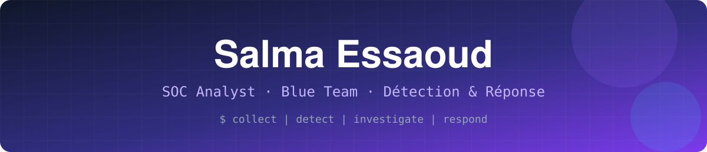

<div align="center">



[](https://github.com/SALMA-ESSAOUD)


[](https://linkedin.com/in/salma-essaoud)
[](mailto:s.essaoudsalmaa@gmail.com)

</div>

---

## 💻 `whoami`

```bash
$ whoami
salma-essaoud

$ cat profile.txt
role      : Élève ingénieure en Cybersécurité (5ème année)
school    : FST Marrakech, Université Cadi Ayyad
focus     : SOC Analyst · Détection · Corrélation · Réponse à incident
tools     : Wazuh · Splunk · ELK · Graylog · FortiGate · Suricata
languages : Arabe · Français · Anglais
status    : 🟢 Disponible pour un stage PFE (SOC / Blue Team)
```

---

## 🔵 Mon quotidien de SOC

```
  📥 Collecter  →  🔎 Détecter  →  🧠 Investiguer  →  🛑 Répondre  →  🔧 Améliorer
   logs, Syslog     règles,          corrélation,        blocage,         tuning,
   Sysmon, IDS      décodeurs,       enrichissement      playbooks,       faux positifs,
                    MITRE ATT&CK     CTI                 SOAR             KPIs (MTTD)
```

Ma priorité : **des alertes qui comptent**. Je construis les règles, je les teste, je réduis le bruit, puis je mesure l'amélioration. Pour bien détecter, j'ai aussi appris à reproduire les attaques en laboratoire.

---

## 🚨 Dernière alerte détectée

```json
{
  "rule": {
    "level": 12,
    "description": "Profil SOC / Blue Team détecté : candidate PFE",
    "mitre": { "id": "T1078", "technique": "Valid Accounts" }
  },
  "agent": { "name": "salma-essaoud", "location": "Marrakech, MA" },
  "full_log": "Action recommandée : contacter pour un stage PFE"
}
```

---

## 🛡️ Projets SOC

### 🔍 Mini-SOC Purple Team *(stage chez Iventeq)*
> Wazuh · OPNsense · Suricata · OpenVPN · YARA

Un SOC complet sur laboratoire isolé multi-VM. Règles et décodeurs personnalisés (brute force SSH/RDP, scan Nmap, injection SQL, path traversal), détection de vol d'identifiants VPN, Active Response de type EDR/XDR, et blocage automatique d'IP via l'API REST d'OPNsense. Résultat : couverture MITRE ATT&CK et KPIs (MTTD, faux positifs) mesurés sur **+6300 événements**.

### 🤖 SOC Loop *(en cours)*
> FortiGate · Graylog · Coraza WAF · T-Pot · Cortex · MISP · OpenCTI · DFIR-IRIS · Python

Une architecture de détection et de réponse automatisée par IA : logs centralisés dans Graylog, enrichissement CTI, gestion de cas, blocage FortiGate avec **validation humaine**, virtual patching WAF, et un agent IA qui trie les alertes et les mappe sur MITRE ATT&CK et OWASP Top 10.

### 🧱 Architecture d'entreprise sécurisée
> pfSense · Suricata inline · OpenVPN · Ubuntu · Wireshark

Réseau segmenté WAN/LAN, VPN avec PKI interne, IDS/IPS inline avec règles personnalisées, hardening Linux, attaques simulées et validées via Wireshark.

### 🏰 Active Directory : comprendre l'attaquant pour mieux détecter
> Windows Server 2019 · Kali · BloodHound · Impacket

Kill chain complète (Kerberoasting, AS-REP Roasting, Pass-the-Hash, DCSync) avec rapport CVSS. Ce laboratoire m'aide à savoir quelles traces une attaque laisse dans les logs.

### 🔬 Autres travaux

| Projet | En bref |
|---|---|
| [CVE-2024-38063](https://github.com/SALMA-ESSAOUD/CVE-CVSS--CVE-2024-38063-IPv6-TCP-IP-Remote-Code-Execution-Analysis) | Analyse d'une RCE IPv6 et scoring CVSS |
| [Post-Quantum Cryptography : Kyber](https://github.com/SALMA-ESSAOUD/Post-Quantum-Cryptography-Kyber-Study-Implementation) | Étude et implémentation de ML-KEM |
| [DES, 3DES, AES](https://github.com/SALMA-ESSAOUD/Performance-Analysis-of-DES-3DES-and-AES-Algorithms-Using-ECB-CBC-and-CFB-Modes) | Comparaison de performance ECB, CBC, CFB |

---

## 🧰 Boîte à outils SOC

**SIEM et logs :** `Wazuh` `Splunk` `ELK Stack` `Graylog` `Sysmon` `Syslog`

**Détection :** `Suricata (IDS/IPS)` `YARA` `FIM` `VirusTotal` `MITRE ATT&CK` `Honeypot T-Pot`

**Pare-feu et WAF :** `FortiGate` `pfSense` `OPNsense` `Coraza WAF` `OWASP CRS`

**CTI et réponse à incident :** `Cortex` `MISP` `OpenCTI` `DFIR-IRIS` `AbuseIPDB`

**Réseau et VPN :** `OpenVPN` `PKI` `Wireshark`

**Méthodes :** `Triage d'alertes` `Corrélation` `Tuning des règles` `Réduction des faux positifs` `MTTD` `SOAR`

**🌱 En apprentissage :** `Microsoft Sentinel` `IBM QRadar` `Sigma` `Zeek`

<details>
<summary><b>🔴 Comprendre l'attaquant</b></summary>
<br>

`Nmap` `Hydra` `BloodHound` `CrackMapExec` `Impacket` `Hashcat` `Kerberoasting` `AS-REP Roasting` `Pass-the-Hash` `DCSync` `GoPhish` `CVE / CVSS`
</details>

<details>
<summary><b>💻 Dev, IA, systèmes et cryptographie</b></summary>
<br>

`Python` `C` `Java` `JavaScript` `PHP` `Spring Boot` `React` `MySQL`
`scikit-learn` `pandas` `Random Forest` `LLM`
`Linux` `Windows` `Active Directory` `Docker` `Git` `GitLab CI/CD`
`AES` `RSA` `SHA-256` `ML-KEM (Kyber)`
</details>

---

## 🏆 Compétitions et certifications

- 🥷 **MACC2026** (DGSSI & SecDojo) : compétition nationale de cybersécurité
- 🚩 **ST4F1T CTF 2025** (GCDSTE / ENSA Marrakech)
- 🏜️ **Rally IA FutureLab, Merzouga** : parmi +1000 jeunes talents des 12 régions du Maroc, thème Security & Sovereignty
- 🎓 **Fortinet NSE 3** · **TryHackMe** (SOC Level 1, Cybersecurity 101, AI Security) · **Cisco** (Introduction à la cybersécurité, Ethical Hacker)

---

<div align="center">

### 🤝 Parlons SOC, détection et stage PFE

[](https://linkedin.com/in/salma-essaoud)
[](mailto:s.essaoudsalmaa@gmail.com)

<sub>Tous les labs sont réalisés dans des environnements isolés, à des fins pédagogiques.</sub>

</div>
